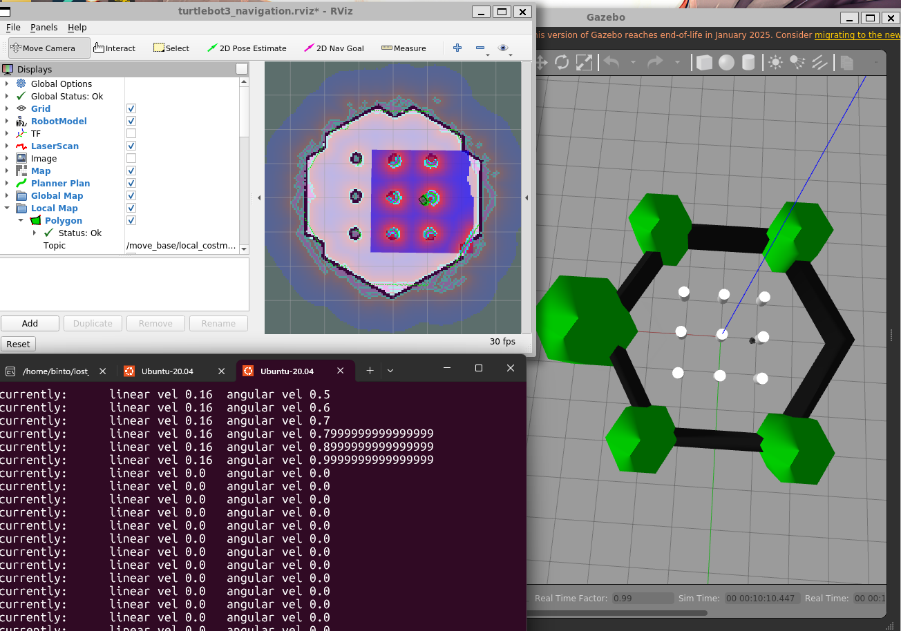
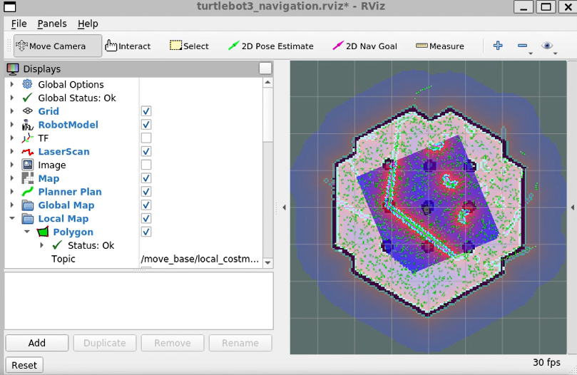

# Lost Robot — Global Localization Using AMCL in ROS 1

An autonomous mobile robotics simulation resolving the classic **Kidnapped / Lost Robot** problem in ROS 1 Noetic and Gazebo using Adaptive Monte Carlo Localization (AMCL).

---

## 📌 Project Overview
The "Lost Robot" problem occurs when a mobile robot initializes within a known, pre-mapped environment with zero prior knowledge of its starting coordinates. 

This project simulates the complete probabilistic convergence pipeline:
1. **Global Scattering:** Initializes with uniform distribution across all open space via the `/global_localization` service.
2. **Bayesian Filtering:** Ingests live 2D planar LiDAR scans (`/scan`) and wheel odometry (`/odom`).
3. **Resampling & Convergence:** Uses KLD-sampling and likelihood field matching to prune improbable hypotheses and consolidate particles onto the true robot pose.

---

## 🛠️ System Architecture & Specifications

| Component | Specification |
| :--- | :--- |
| **Operating System** | Ubuntu 20.04 LTS (WSL / Native) |
| **Middleware** | ROS 1 Noetic |
| **Physics Simulator** | Gazebo 11 |
| **Robot Model** | TurtleBot3 Burger |
| **Simulation World** | `turtlebot3_world`[cite: 1, 4] |
| **Localization Node** | `amcl` (Adaptive Monte Carlo Localization)[cite: 1, 4] |
| **Laser Model** | `likelihood_field`[cite: 1, 4] |
| **Odometry Model** | `diff` (Differential Drive)[cite: 1, 4] |
| **Map Parameters** | Resolution: `0.05 m/pixel`, Occupied Thresh: `0.65`, Free Thresh: `0.196`[cite: 1, 4] |

---

## 🚀 Installation & Build Pipeline

1. **Create and initialize the Catkin workspace:**
   ```bash
   mkdir -p ~/lost_robot/src
   cd ~/lost_robot/src
   ```[cite: 1, 4]

2. **Clone required simulation packages:**
   ```bash
   git clone -b noetic-devel [https://github.com/ROBOTIS-GIT/turtlebot3_msgs.git](https://github.com/ROBOTIS-GIT/turtlebot3_msgs.git)
   git clone -b noetic-devel [https://github.com/ROBOTIS-GIT/turtlebot3.git](https://github.com/ROBOTIS-GIT/turtlebot3.git)
   git clone -b noetic-devel [https://github.com/ROBOTIS-GIT/turtlebot3_simulations.git](https://github.com/ROBOTIS-GIT/turtlebot3_simulations.git)
   ```[cite: 1, 4]

3. **Build workspace:**
   ```bash
   cd ~/lost_robot
   catkin_make
   ```[cite: 1, 4]

---

## ⚡ Execution Pipeline

Run each command in a separate terminal:

### Terminal 1: Launch Gazebo Physics Simulation
```bash
cd ~/lost_robot
source devel/setup.bash
export TURTLEBOT3_MODEL=burger
roslaunch turtlebot3_gazebo turtlebot3_world.launch
```[cite: 1, 4]

### Terminal 2: Launch AMCL & RViz Navigation Stack
```bash
cd ~/lost_robot
source devel/setup.bash
export TURTLEBOT3_MODEL=burger
roslaunch turtlebot3_navigation turtlebot3_navigation.launch map_file:=$HOME/lost_robot/src/turtlebot3/turtlebot3_navigation/maps/map.yaml
```[cite: 1, 4]

### Terminal 3: Trigger "Lost" State & Drive Robot
```bash
cd ~/lost_robot
source devel/setup.bash

# 1. Reset particles to uniform global distribution
rosservice call /global_localization "{}"

# 2. Teleoperate robot to drive particle convergence
export TURTLEBOT3_MODEL=burger
rosrun turtlebot3_teleop turtlebot3_teleop_key
```[cite: 1, 4]

## 📊 Experimental Results & Outputs

### 1. Simulation & Teleoperation Environment
Gazebo simulation running alongside RViz and the keyboard teleoperation node:



---

### 2. Initial State (Total Positional Uncertainty)
* Calling `/global_localization` resets the belief state across the entire map[cite: 1, 4].
* In RViz, the `/particlecloud` appears as a completely scattered cloud of orientation arrows covering all traversable free space[cite: 1, 4].
* Robot state: **Completely lost ($P(x_0)$ is uniformly distributed)**[cite: 1, 4].



---

### 3. Transition & Final Converged State
* As velocity commands (`/cmd_vel`) are published via the teleoperation node[cite: 1, 4]:
  * The differential drive motion model shifts candidate particles[cite: 1, 4].
  * The `likelihood_field` compares incoming 2D LiDAR wall hits with known obstacles in `map.yaml`[cite: 1, 4].
  * Non-matching particles are pruned while matching poses are duplicated[cite: 1, 4].
* **Final State:** The particle cloud collapses into a single dense cluster directly under the robot model, with LiDAR rays aligned flush against the static walls[cite: 1, 4].---

### 3. Transition & Video Demonstration
Live screen recording showing keyboard teleoperation commands and real-time AMCL particle cloud convergence in Gazebo and RViz:

[](https://drive.google.com/file/d/1mADOasKqxcXqlHfQ8iZ0FYMg3wwA21_A/view?usp=sharing)

> 📹 **[Click here to watch the full execution video on Google Drive](https://drive.google.com/file/d/1mADOasKqxcXqlHfQ8iZ0FYMg3wwA21_A/view?usp=sharing)**

## 📁 Repository Structure
```text
lost_robot/
├── src/
│   ├── turtlebot3/                 # TurtleBot3 core metapackage
│   ├── turtlebot3_msgs/            # ROS message definitions
│   └── turtlebot3_simulations/     # Gazebo simulation worlds and launch files
├── .gitignore                      # Excludes build/ and devel/
└── README.md                       # Project documentation
